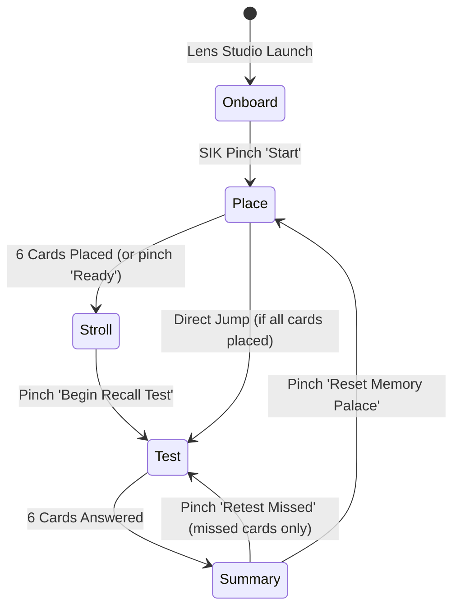

# Loci Lens — Functional Specification & Technical Plan

## 1. System Architecture

```
+-------------------------------------------------------------------------+
|                              Loci Lens Runtime                          |
+-------------------------------------------------------------------------+
|                                                                         |
|  [InputLayer]  <--->  [Spectacles Interaction Kit (SIK) / Preview Mouse]|
|         |                                                               |
|         v                                                               |
|  [LociManager] (State Machine: Onboard -> Place -> Stroll -> Test)     |
|    |      |                                                             |
|    |      +---------> [ReviewStore] (Leitner 3-Box Engine)              |
|    |      |                                                             |
|    |      +---------> [AudioFx] (Spatial Chimes & Direction Cues)       |
|    |                                                                    |
|    +----------------> [PeripheralHUD] (18° Margin Progress Ring)       |
|    |                                                                    |
|    +----------------> [CardObject 0..5]                                 |
|                         |                                               |
|                         +---> [LocusAnchor] (World Spatial Pose)        |
|                         +---> [DeckData] (Mnemonic Curriculum Record)   |
|                         +---> [Visual Billboard & SUIK BackPlate]       |
+-------------------------------------------------------------------------+
```

---

## 2. Core Data Models (TypeScript)

### LearningCard
```typescript
export interface LearningCard {
  id: string;
  order: number;
  topic: string;
  question: string;
  answer: string;
  mnemonicCue: string;
  iconName: string;
  suggestedLocus: string;
}
```

### LocusRecord
```typescript
export interface LocusRecord {
  id: string;
  cardId: string;
  worldPosition: [number, number, number]; // x, y, z in cm
  worldRotation: [number, number, number, number]; // quaternion [x, y, z, w]
  locusName: string;
  isPlaced: boolean;
  placedTimestamp: number;
}
```

### ReviewRecord (Leitner System)
```typescript
export interface ReviewRecord {
  cardId: string;
  box: 1 | 2 | 3; // Box 1 = Daily/Active, Box 2 = Intermediate, Box 3 = Mastered
  correctCount: number;
  missedCount: number;
  lastOutcome: "got_it" | "missed" | "untested";
  lastReviewedAt?: number;
}
```

### SessionState
```typescript
export type LensMode = "onboard" | "place" | "stroll" | "test" | "summary";

export interface SessionMetrics {
  totalCards: number;
  placedCards: number;
  testedCards: number;
  correctCards: number;
  missedCards: number;
  accuracyPercentage: number;
}
```

---

## 3. Demo Curriculum Deck (6 Cards)

| ID | Topic | Mnemonic Cue | Question Prompt | Revealed Answer | Suggested Locus |
|---|---|---|---|---|---|
| `card_1` | Biology | 🌱 Glowing Chloroplast | *What is the light-absorbing pigment in photosynthesis?* | **Chlorophyll-a** (absorbs red & blue light wavelengths) | Desk Lamp |
| `card_2` | Physics | ⚡ Quantum Spark | *What constant relates a photon's energy to its frequency?* | **Planck's Constant** ($h \approx 6.626 \times 10^{-34}\ \text{J}\cdot\text{s}$) | Power Outlet / Charger |
| `card_3` | History | 🏛️ Golden Laurel | *In what year did the Roman Senate bestow the title 'Augustus'?* | **27 BCE** (marking the founding of the Roman Empire) | Main Entry Doorway |
| `card_4` | Astronomy | 🪐 Crimson Eye | *Which Martian volcano is the tallest planetary mountain?* | **Olympus Mons** (stands approx. 21.9 km high) | Bookshelf Top Shelf |
| `card_5` | Chemistry | 🧪 Molecular Hexagon | *What aromatic compound exhibits delocalized $\pi$-ring stability?* | **Benzene** ($\text{C}_6\text{H}_6$, Kekulé resonance ring) | Coffee Table |
| `card_6` | Computer Science | 🌲 Binary Locus Tree | *What self-balancing binary search tree guarantees $O(\log n)$?* | **AVL Tree / Red-Black Tree** | Window Sill |

---

## 4. State Machine Transitions



### Transition Specifications:
1. **Onboard → Place**:
   - Condition: User clicks or pinches the "Start Placement" button.
   - Action: Displays Card 1 locus icon following user gaze raycast at 1.1 m.
2. **Place → Place (Next Card)**:
   - Condition: User pinches on target surface.
   - Action: Pins active card to world position; plays `AudioFx.placeTone`; updates Peripheral HUD; advances to Card 2..6.
3. **Place → Stroll / Test**:
   - Condition: All 6 cards placed.
   - Action: Displays completion banner; activates navigation indicators.
4. **Test (Card Navigation)**:
   - Condition: User looks at locus card and pinches card plate.
   - Action: Flip animation triggers; reveals hidden answer; presents "Got It" and "Missed" SIK buttons.
5. **Test (Scoring)**:
   - Condition: User pinches "Got It" or "Missed".
   - Action: `ReviewStore` updates card box; card marks green/amber glow; advances to next locus; when count == 6, opens Summary.
6. **Summary Actions**:
   - "Retest Missed": Resets tested state only for cards with `lastOutcome === 'missed'`, enters Test mode scoped to those cards.
   - "Reset All": Clears placements and review records, returns to Place mode.

---

## 5. Comfort & Spatial Layout Constants

Grounded in official Snap Spectacles design guidelines and optical limits:

- **Focus Distance**: Main interaction plane fixed at **1.1 meters** (Snap focus sweet spot).
- **Usable Field of View**: 37° vertical × 32° horizontal.
- **CardObject Dimensions**: 32 cm width × 22 cm height.
- **Text Sizing**:
  - Title / Prompt: 42 pt bold (legible from 1.5 m).
  - Body / Answer: 34 pt medium.
  - Category / Badge: 24 pt semi-bold.
- **Peripheral HUD**: Positioned at [x: +28 cm, y: -20 cm, z: -110 cm], angular offset approx. 18° off-axis.
- **Interaction Targets**: Minimum button hit-box 12 cm × 5 cm with generous 2 cm padding.
- **Color Palette (Additive Display Safe)**:
  - Background Plate: `#121620` (with 85% opacity backdrop filter).
  - Primary Text: `#FFFFFF` (High luminance).
  - Accent / Accent Glow: `#38BDF8` (Cyan, high see-through contrast).
  - Got It (Success): `#22C55E` (Emerald Green).
  - Missed (Alert): `#F59E0B` (Vibrant Amber).
  - Locus Marker: `#A855F7` (Luminous Purple).
