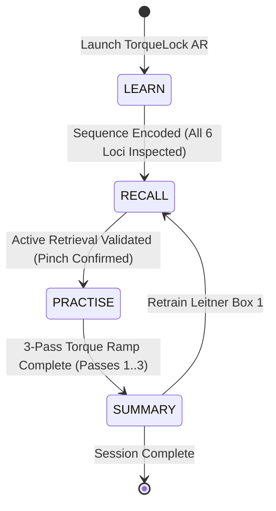

# TorqueLock AR — Functional Specification & Technical Plan

## 1. System Architecture

```
+--------------------------------------------------------------------------------------------------+
|                                    TorqueLock AR Runtime                                         |
+--------------------------------------------------------------------------------------------------+
|                                                                                                  |
|  [SIKInteractionController] <---> [Spectacles Interaction Kit (SIK) / Preview Pointer Simulator] |
|              |                                                                                   |
|              v                                                                                   |
|  [SequenceEngine] (Headless TypeScript State Machine: LEARN -> RECALL -> PRACTISE -> SUMMARY)   |
|     |        |                                                                                   |
|     |        +---------> [MemoryTrainer] (Method of Loci Spatial Mnemonic Engine)                |
|     |        |                                                                                   |
|     |        +---------> [FocusController] (Cognitive LOD Knapsack: Henderson & Feiner / Lindl)  |
|     |        |                                                                                   |
|     |        +---------> [ReviewStore] (Leitner 3-Box Spaced Repetition Persistence)             |
|     |                                                                                            |
|     +------------------> [FlangeSceneController]                                                 |
|     |                         |                                                                  |
|     |                         +---> [FlangeMesh] (1:1 42x8x42 cm at 0, -18, -115 cm)             |
|     |                         +---> [BoltNodes 1..6] (M20 Hex Fastener Loci at 15 cm radius)     |
|     |                         +---> [ActiveTargetRing] (9 cm OD, Cyan #00F0FF)                   |
|     |                         +---> [GasketCrushPlane] (Normal / 1.8mm Warped Coral #FF4D4D)     |
|     |                                                                                            |
|     +------------------> [PreviewSimulationController] (Simulated BLE Torque Wrench Stand-in)    |
+--------------------------------------------------------------------------------------------------+
```

---

## 2. Core Data Models (TypeScript)

### FlangeBoltNode
```typescript
export interface FlangeBoltNode {
  id: number;                   // Bolt number 1..6
  angleDeg: number;             // 90 (TDC), 30, 330, 270 (BDC), 210, 150
  worldPosition: [number, number, number]; // [x, y, z] in cm
  mnemonicRole: string;         // "Anchor Locus", "Cross Locus", "Shift Locus", "Closure Locus"
  proceduralCue: string;        // Human-readable mnemonic instructions
  currentTorqueNm: number;      // Current simulated torque (0, 35, 70, 100 Nm)
  targetTorqueNm: number;       // Pass target torque
  isTorqued: boolean;           // True if torqued in current pass
}
```

### TorquePassRecord
```typescript
export interface TorquePassRecord {
  passNumber: number;           // 1, 2, or 3
  targetTorqueNm: number;       // 35 Nm (Pass 1), 70 Nm (Pass 2), 100 Nm (Pass 3)
  nominalGasketCrushPct: number;// 40% (Pass 1), 70% (Pass 2), 100% (Pass 3)
  sequenceOrder: number[];      // [1, 4, 2, 5, 3, 6] (ASME PCC-1 Star Pattern)
  completedBolts: number[];     // Bolts tightened in order
  isComplete: boolean;
}
```

### GasketWarpState
```typescript
export interface GasketWarpState {
  isWarped: boolean;            // True if non-uniform sequence triggers warp
  deflectionMm: number;         // Calculated warp deflection (e.g. 1.80 mm)
  deflectionThresholdMm: number;// 1.50 mm (ASME PCC-1 safety limit)
  warpedBoltPair: [number, number]; // e.g. [1, 2] (improper adjacent tightening)
  alertMessage: string;         // Warning displayed in HUD
}
```

### LeitnerReviewRecord
```typescript
export interface LeitnerReviewRecord {
  boltId: number;
  box: 1 | 2 | 3;               // 1: Daily Retest, 2: 3-Day Review, 3: Mastered
  consecutiveSuccesses: number;
  lastAttemptTimestamp: number;
  lastOutcome: 'correct' | 'missed';
}
```

---

## 3. Spatial Comfort & Optical Constants

| Parameter | Value | Reference / Justification |
|---|---|---|
| **Optical Display Cone** | $37^\circ\text{ V} \times 32^\circ\text{ H}$ | Snap SPECS 27 Hardware Waveguide specification |
| **Comfortable Focal Plane** | $1.15\text{ m}$ ($-115\text{ cm}$) | SPECS default optical vergence distance ($1.1 - 1.2\text{ m}$) |
| **Flange Center Origin** | $(0, -18, -115)\text{ cm}$ | Sits on workbench inside comfortable down-look cone |
| **Eye-Level Clear Zone** | $y = -4\text{ cm}$ to $+15\text{ cm}$ | Kept completely empty to prevent central vision obstruction |
| **Lower Interaction Dock** | $(0, -28, -105)\text{ cm}$ | RULA biomechanics; eliminates "gorilla arm" fatigue (Evangelista Belo et al., CHI 2021) |
| **Bolt Circle Radius** | $15\text{ cm}$ ($30\text{ cm}$ PCD) | 1:1 scale ASME Class 150 / 300 6-bolt pipe flange |
| **Active Target Ring** | $9.0\text{ cm}$ Outer Diameter | High-luminance Cyan (`#00F0FF`); hugs bolt head |
| **Focus Mode Status Pill** | $(0, -6, -110)\text{ cm}$ | Eyes-up 1-line tag (`P1 · B1 · 35 Nm`); replaces 2-line floating tag |

---

## 4. State Machine Transitions



1. **LEARN:** Highlights bolts $1 \rightarrow 4 \rightarrow 2 \rightarrow 5 \rightarrow 3 \rightarrow 6$. Each locus presents an expanded 2-line specification tag and procedural role.
2. **RECALL:** Hides visual star lines and numbers. Technician pinches candidate bolt. Correct pinch advances; error logs to Leitner Box 1.
3. **PRACTISE:** Progressive torque ramp ($35 \rightarrow 70 \rightarrow 100\text{ Nm}$). Activating tool engages Focus Mode (tag collapses into 1-line pill). If an adjacent bolt is torqued out-of-order, Gasket Warp Alert triggers with $1.8\text{ mm}$ deflection warning.
4. **SUMMARY:** Displays accuracy, pass efficiency, and Leitner 3-box distribution. Offers one-pinch remediation loop for Box 1 items.

---

## 5. Automated LEAF Scenarios (C1–C6)

- **C1: Initial Spatial Layout & Star Target #1:** Verifies flange is positioned at $(0, -18, -115)\text{ cm}$, all 6 bolt nodes are mapped to correct polar coordinates, and Bolt 1 is the initial target.
- **C2: Comprehension-to-Psychomotor LOD Transition & Star Advance:** Validates advance from Bolt 1 to Bolt 4 and verifies Focus Mode tag collapse.
- **C3: Out-of-Sequence Gasket Warp Alert & Recovery:** Simulates premature torquing of adjacent Bolt 2 after Bolt 1, verifying calculation of $1.8\text{ mm}$ deflection, coral alert display, and recovery back to star pattern.
- **C4: Focus Mode Progressive Disclosure:** Verifies cognitive knapsack solver reduces secondary text to a 1-line eyes-up status indicator during active wrenching.
- **C5: Full Pass Completion & Seal Summary:** Executes full sequence $1 \rightarrow 4 \rightarrow 2 \rightarrow 5 \rightarrow 3 \rightarrow 6$ across passes, verifying pass ramp and uniform gasket seating.
- **C6: Ergonomic Reach & Waveguide Safe Zone:** Verifies all interactable elements comply with CHI 2021 ergonomic envelope and stay within SPECS optical frustum.
